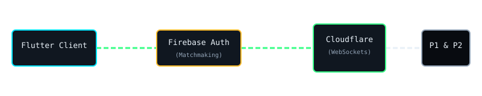

  

   
  
  

   
  

    <code style="color: #00E5FF; background: transparent;">"Build with purpose. Debug with evidence. Ship with confidence."</code>
  

  

  

## ▰ About Me

I am a **PHP & Laravel Developer**, cross-platform **Flutter Engineer**, and full-stack software problem solver building under the identity **PROGRAMMER BRIJESH** (project alias: **DarkCypher**). 

My engineering focus is not just on writing code, but on building practical applications, debugging production-style anomalies, integrating complex external APIs (like Shopify and Amazon SP-API), and designing resilient software architectures. I leverage AI as a powerful development multiplier, but I rely on deep foundational understanding to decompose problems, review implementations, and enforce technical integrity.

  

## ▰ Core Technical Specializations

  
### ⚙️ Backend & Architecture

 

REST APIs | Auth Workflows | Middleware | Request Lifecycle Debugging | Eloquent ORM | Schema Design

### 💻 Frontend Development

 

Blade Templates | Responsive UI | CSS Animations | Dashboard Interfaces | Component-Oriented Design

### 📱 Mobile & Cross-Platform

 

Cross-Platform Builds | Local Persistence | Firebase Auth | App UI/UX | State Management

### 🔌 API & E-Commerce Integrations

 

Shopify Admin API | Amazon SP-API | OAuth Sessions | WebSockets | Inventory Sync | Payload Validation

### 🛠 Cloud, Automation & Tooling

 

Composer | CI/CD Workflows | Cloudflare Durable Objects | AI-Assisted Implementation

  

## ▰ Project Showcase

### 1️⃣ ZeoSync / AmazonSync
**A high-performance Shopify-to-Amazon integration engine.**
This Laravel-based application bridges Shopify stores with Amazon Seller Central, managing complex data synchronization, authentication workflows, and dynamic product mapping.

  

* **Core Challenges Handled:** Shopify OAuth, Subscription/Billing logic, Amazon SP-API request optimization, dynamic variant schemas, caching, and resilient API error handling.
* **Tech Stack:** Laravel, PHP, MySQL, Shopify API, Amazon SP-API, REST/GraphQL.
* **Links:** [Repository](#repo-link-placeholder) | [Live Demo](#demo-link-placeholder)

 

### 2️⃣ DarkCypher Chess
**Cross-platform local and online multiplayer chess application.**
Built entirely with Flutter and Dart, blending complex game-state management with real-time server-authoritative multiplayer infrastructure.

  

* **Core Challenges Handled:** Chess logic engines, WebSocket matchmaking, Firebase Auth integration, server-authoritative state via Cloudflare Durable Objects, and GitHub Actions Android build pipelines.
* **Tech Stack:** Flutter, Dart, Firebase, WebSockets, Cloudflare Workers.
* **Links:** [Repository](#repo-link-placeholder) | [Live Demo](#demo-link-placeholder)

 

### 3️⃣ FilePilot & Developer Portfolio
* **FilePilot:** An everyday utility application built in Flutter featuring image compression, PDF handling, and reusable cross-platform UI components.
* **DarkCypher Portfolio:** A highly-animated, technically accurate digital identity utilizing HTML, CSS, JavaScript, and custom SVG motion graphics.

  

## ▰ Security & Engineering Philosophy

**Cybersecurity Learning & Interests:** Web application security, OWASP fundamentals, exploring Linux/Kali Linux, understanding SQL injection and XSS in authorized environments. I believe secure software begins with understanding how insecure software breaks.

**Debugging Protocol:** I treat bugs as evidence left behind at a crime scene. I rely on logs, request tracing, and payload validation over guesswork.

  

## ▰ System Telemetry (GitHub Statistics)

  <table>
    <tr>
      <td align="center">
        
      </td>
      <td align="center">
        
      </td>
    </tr>
  </table>

  ### 🐍 Contribution Activity Heatmap
  <!-- The image below is generated by the GitHub Actions Workflow -->
  <picture>
    <source media="(prefers-color-scheme: dark)" srcset="dist/github-contribution-grid-snake-dark.svg">
    <source media="(prefers-color-scheme: light)" srcset="dist/github-contribution-grid-snake.svg">
    
  </picture>
  
  
*Statistics are fetched via external APIs and may occasionally be delayed.*

  

## ▰ CONNECT WITH BRIJESH

  

  

    <code style="color: #00E5FF; background: transparent;">> initiating_secure_handshake...</code> 
    <code style="color: #39FF88; background: transparent;">> connection_established: true</code>  
    Whether you're looking for a full-stack engineer, a cross-platform mobile developer, or a technical collaborator, my communication channels are open.
  

 

  <table>
    <tr>
      <td align="center" width="220">
        
      </td>
      <td>
        <b>Portfolio Website</b> 
        Explore my development work and technical journey.
      </td>
    </tr>
    <tr>
      <td align="center" width="220">
        
      </td>
      <td>
        <b>GitHub</b> 
        Explore my code, repositories, and development projects.
      </td>
    </tr>
    <tr>
      <td align="center" width="220">
        
      </td>
      <td>
        <b>LinkedIn</b> 
        Connect with me professionally.
      </td>
    </tr>
    <tr>
      <td align="center" width="220">
        
      </td>
      <td>
        <b>YouTube</b> 
        Watch my developer-related content.
      </td>
    </tr>
    <tr>
      <td align="center" width="220">
        
      </td>
      <td>
        <b>Instagram</b> 
        Follow my DarkCypher identity and creative updates.
      </td>
    </tr>
    <!-- To add Email or WhatsApp later, copy the row format above -->
  </table>

 

  <code>system.exit(0); // Mission Accomplished.</code>

