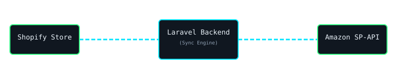
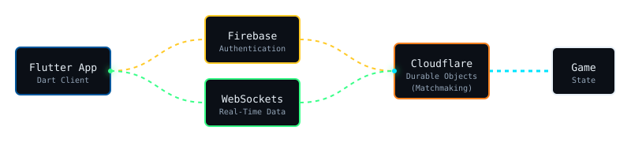
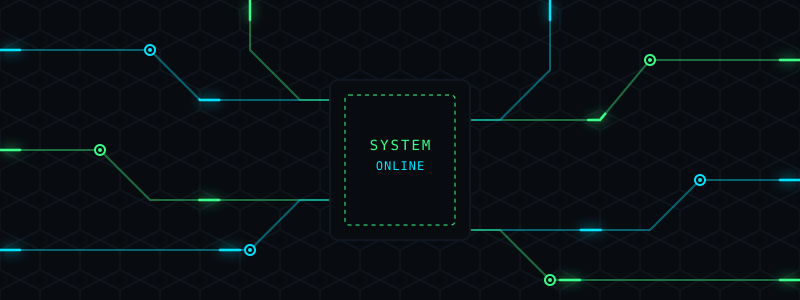
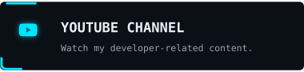
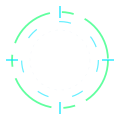

  

  

   
  

    <code style="color: #00E5FF; background: transparent;">"Build. Debug. Engineer. Repeat."</code>
  

  

## ▰ System Initialization

  

I am a **PHP & Laravel Developer**, cross-platform **Flutter Engineer**, and full-stack software problem solver building under the identity **PROGRAMMER BRIJESH** (project alias: **DarkCypher**). 

My engineering focus revolves around practical application building, debugging complex production-style anomalies, integrating external APIs (like Shopify and Amazon SP-API), and designing resilient software architectures. I rely on deep foundational understanding to decompose problems, review implementations, and enforce technical integrity.

  

## ▰ Core Technical Stack

  
### ⚙️ Backend & Architecture

 

REST APIs | JSON | Auth Workflows | Middleware | Database Fundamentals (MySQL/SQL)

### 💻 Frontend Development

 

Blade Templates | Responsive UI | CSS Animations | React & Next.js

### 📱 Mobile & Cross-Platform

 

Flutter | Dart | Cross-Platform Builds | Mobile UI/UX | Firebase Integration

### 🛠 Tools, Deployment & Automation

 

Composer | npm | Git Workflows | XAMPP | Cloudflare Workers | Troubleshooting & API Debugging

  

## ▰ Technical Architecture & Projects

### 1️⃣ ZeoSync / AmazonSync
**A high-performance Shopify-to-Amazon integration engine.**
This Laravel-based backend bridges Shopify stores with Amazon Seller Central, handling complex API request flows, data mapping, and inventory synchronization.

  

* **Architecture Highlights:** Shopify Admin API ingestion, dynamic product variant schemas, caching optimizations, Amazon SP-API request validation, and resilient API error handling.
* **Tech Stack:** Laravel, PHP, MySQL, Shopify API, Amazon SP-API.

 

### 2️⃣ DarkCypher Chess
**Cross-platform local and online multiplayer chess application.**
Built entirely with Flutter and Dart, blending complex game-state management with real-time server-authoritative matchmaking.

  

* **Architecture Highlights:** WebSocket matchmaking, Firebase Auth integration, server-authoritative state management, and real-time multiplayer capability.
* **Tech Stack:** Flutter, Dart, Firebase, WebSockets.

 

### 3️⃣ FilePilot & Developer Portfolio
* **FilePilot:** An everyday utility application built in Flutter featuring robust file utilities, image compression, PDF handling, and reusable cross-platform UI components.
* **Programmer Brijesh Portfolio:** A highly-animated, technically accurate digital identity utilizing HTML, CSS, JavaScript, and custom SVG motion graphics.

  

## ▰ System Telemetry

  <table>
    <tr>
      <td align="center">
        
      </td>
      <td align="center">
        
      </td>
    </tr>
  </table>

 <!-- Animated Procedural Cyber Circuit -->
  

  

## ▰ CONNECT WITH BRIJESH

  

 

<!-- Premium Animated Cyber Cards Grid -->

  
  
   
  
  
   
  

   
  
   
  

    <code>system.exit(0); // Build with purpose. Debug with evidence. Ship with confidence.</code>
  

